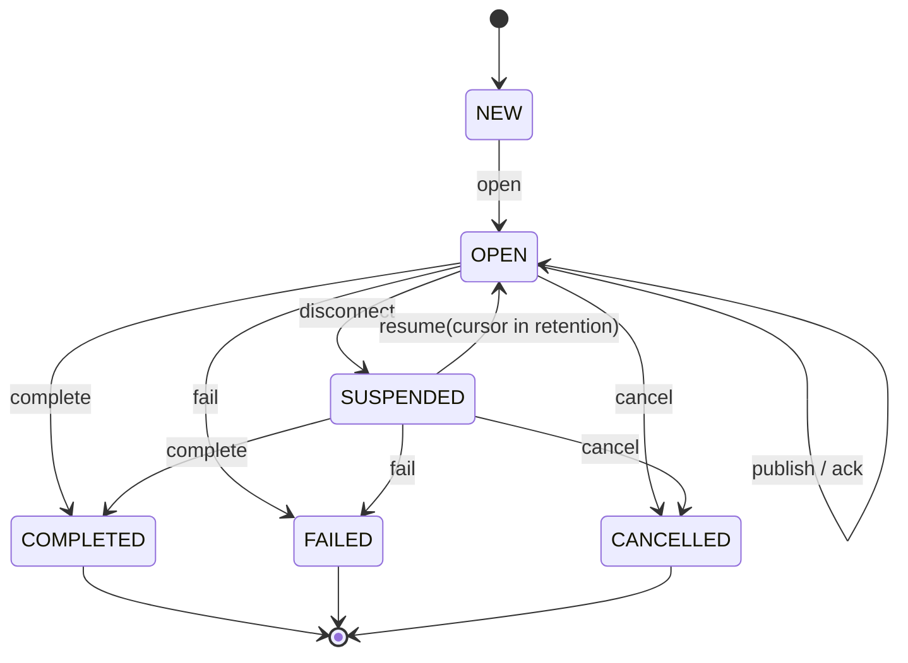

# Stream and resume contract

Status: draft v0.1. A stream has a server-issued stable stream ID, monotonically increasing event sequence numbers starting at 1, and an acknowledged cursor. A cursor is the greatest contiguous sequence the client confirms it has consumed. The initial cursor is 0.

## Rules

1. Publish is accepted only in `OPEN`. Sequence numbers are assigned once and never reused.
2. A stream-scoped idempotency key contains 1–128 UTF-8 bytes. A repeated key with the same payload returns the original sequence and creates no second event. Reusing a key with different payload bytes returns `OS-0401`.
3. A stream has hard limits for retained unacknowledged events, total unique idempotency records, per-event and total payload bytes, and lifetime. The reference model enforces finite event, dedupe-record, and payload-byte limits; production configuration must also specify a lifetime limit. Reaching capacity returns `OS-0403` or `OS-0404`; it must not allocate without bound.
4. Acknowledgement is cumulative, monotonic, and cannot exceed the highest published sequence. Acknowledged events may be removed from replay storage.
5. After disconnect, resume supplies the last consumed cursor. If it is older than the earliest retained point, return `OS-0400`; if ahead of the stream, return `OS-0402`. Otherwise replay retained events with sequence greater than the supplied cursor, in sequence order.
6. Resume does not itself acknowledge events. The client acknowledges only after it has durably accepted them. This handles lost acknowledgements without silently skipping data.
7. `COMPLETED`, `FAILED`, and `CANCELLED` are terminal. A failed or cancelled stream is not reopened; application recovery creates a new stream and may use the same application idempotency key.
8. A retry may be delivered more than once across a crash boundary. The protocol promises bounded duplicate suppression, not distributed exactly-once execution. Side-effecting consumers must commit their effect and dedupe record atomically or use an idempotent operation.

The executable stream state machine is the Rust crate `dataplane/sanchar-core`; its public transitions are the production protocol core and deliberately leave persistence to the owning store. The independent Python model in `sim/reference/stream.py` is a simulator cross-check. Both implementations run the shared cases in `spec/conformance/stream-vectors.json`.
